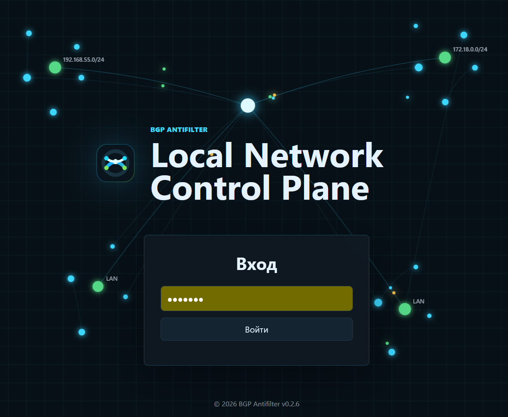
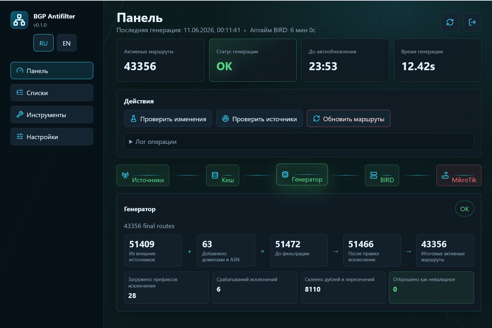

# BGP Antifilter


English | [Русский](README.md)

BGP Antifilter collects IP lists and sends routes to MikroTik over BGP.
Your router uses those routes to send selected traffic through your VPN.
Manage lists and route updates in the web panel.

**Set up your VPN first.** The application updates routes; VPN connectivity is configured separately.



## Requirements

- A Linux server or mini PC with Docker Engine and the Docker Compose plugin.
- MikroTik running RouterOS 7 with a working VPN.
- Network connectivity between MikroTik and the Linux server.

Images support amd64 and arm64. Run the commands below in the Linux server terminal.
For Portainer, follow the [Portainer installation guide](docs/portainer.en.md).

## Installation

### 1. Download the Compose file

```bash
mkdir -p bgp-antifilter
cd bgp-antifilter
curl -fsSL https://raw.githubusercontent.com/LeonidOz/BGP-Antifilter/main/deploy/portainer-stack.yml -o compose.yaml
```

### 2. Set addresses and a password

Create `.env` in the same directory:

```bash
nano .env
```

Paste these settings and replace the addresses and password:

```dotenv
BGP_ANTIFILTER_VERSION=0.5.2
BGP_ANTIFILTER_IMAGE=ghcr.io/leonidoz/bgp-antifilter:${BGP_ANTIFILTER_VERSION}
MT_IP=192.168.55.1
BIRD_IP=192.168.55.5
ROUTER_ID=192.168.55.5
MY_AS=64500
MT_AS=65455
BGP_COMMUNITY=65432,500
ADMIN_PASSWORD='replace-with-your-password'
```

| Setting | What to enter |
| --- | --- |
| `MT_IP` | MikroTik's IP address, reachable from the server |
| `BIRD_IP` | An existing Linux server IP address, reachable from MikroTik |
| `ROUTER_ID` | For a simple network, use the same address as `BIRD_IP` |
| `MY_AS`, `MT_AS` | The BGP AS numbers; keep the example values for a new setup |
| `BGP_COMMUNITY` | A route label; keep the example and use it in the MikroTik filter |
| `ADMIN_PASSWORD` | Your web panel password |

`BIRD_IP` does not create an IP address. Check the server's addresses with `ip -4 addr`.
The first line selects the version; leave the image name on the next line unchanged.

### 3. Start the application

```bash
docker compose up -d
docker compose logs -f --tail=50
```

Docker downloads the prebuilt image. On first startup, the application creates the default
lists and downloads routes. Wait for the first download to finish. Press `Ctrl+C` to leave
the log view; the container keeps running.

Open **http://192.168.55.5:8080**, using your server's address, and enter the password from `.env`.
The panel uses port `8080`. To change it, add `ADMIN_PORT=8081` to `.env` and run
`docker compose up -d` again.
Keep panel access within your LAN or VPN.

Data is stored in Docker volumes and survives container recreation.
Before moving an existing installation to a separate configuration volume, read
the [migration steps](docs/usage.en.md#moving-to-separate-config-storage).

### 4. Connect MikroTik

Follow the [MikroTik BGP setup](docs/mikrotik.en.md).
It uses the same example addresses and shows where to enter your VPN gateway.

### 5. Check the result

The web panel should show routes and an established BGP connection.
On the server, run:

```bash
docker compose ps
docker compose exec bgp-antifilter birdc show protocols
```

After the first download and MikroTik configuration, expect `healthy` and an
`Established` state for the `mikrotik` protocol. Before connecting the router, the
container may show `unhealthy` because its healthcheck expects a BGP connection.

From a device behind MikroTik, check access to a listed resource and confirm its route uses the VPN.

## Next steps

- [Edit lists, adjust updates, or troubleshoot](docs/usage.en.md).
- [Update the application and keep your data](docs/usage.en.md#updating-the-application).
- [Use an Address List instead of BGP](docs/mikrotik.en.md#address-list-instead-of-bgp).
- [Build from source, explore the code structure, and run checks](docs/development.en.md).
- [Changelog](CHANGELOG.md).


