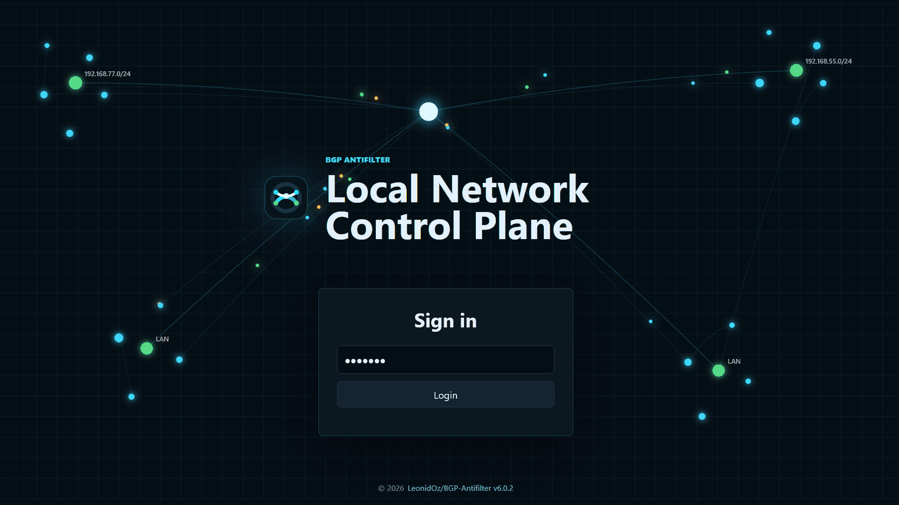

# BGP Antifilter


English | [Русский](README.md)

BGP Antifilter collects IPv4 lists and sends routes to your router over BGP.
Your router uses those routes to send selected traffic through your VPN.
Manage lists and route updates in the web panel.

**Set up your VPN first.** The application updates routes; VPN connectivity is configured separately.



Still screenshots: [sign-in](docs/assets/admin-login-en.png) · [dashboard](docs/assets/admin-dashboard-en.png).

## Requirements

- A Linux server or mini PC with Docker Engine and the Docker Compose plugin.
- A router or server with IPv4 BGP, community filtering, and a way to direct accepted routes into your VPN.
- A working VPN and connectivity between the BGP peer and the Linux server.

Connection examples: [FRRouting](docs/frr.en.md) and [MikroTik RouterOS](docs/mikrotik.en.md). [General BGP requirements](docs/bgp.en.md).

Images support amd64 and arm64. Run the commands below in the Linux server terminal.
For Portainer, follow the [Portainer installation guide](docs/portainer.en.md).

## Installation

### 1. Download the Compose file

```bash
mkdir -p bgp-antifilter
cd bgp-antifilter
curl -fsSL https://raw.githubusercontent.com/LeonidOz/BGP-Antifilter/main/deploy/portainer-stack.yml -o compose.yaml
```

### 2. Set addresses and a password

Create `.env` in the same directory:

```bash
nano .env
```

Paste these settings and replace the addresses and password:

```dotenv
BGP_ANTIFILTER_VERSION=1.0.1
BGP_ANTIFILTER_IMAGE=ghcr.io/leonidoz/bgp-antifilter:${BGP_ANTIFILTER_VERSION}
PEER_IP=192.168.55.1
BIRD_IP=192.168.55.5
ROUTER_ID=192.168.55.5
MY_AS=64500
PEER_AS=65455
BGP_COMMUNITY=65432,500
ADMIN_PASSWORD='replace-with-your-password'
```

| Setting | What to enter |
| --- | --- |
| `PEER_IP` | The BGP peer's IP address, reachable from the server |
| `BIRD_IP` | An existing Linux server IP address, reachable from the BGP peer |
| `ROUTER_ID` | For a simple network, use the same address as `BIRD_IP` |
| `MY_AS`, `PEER_AS` | The BGP AS numbers; keep the example values for a new setup |
| `BGP_COMMUNITY` | A route label; keep the example and use it in the BGP peer's import filter |
| `ADMIN_PASSWORD` | Your web panel password |

`BIRD_IP` does not create an IP address. Check the server's addresses with `ip -4 addr`.
The first line selects the version; leave the image name on the next line unchanged.
Legacy `MT_IP` and `MT_AS` remain supported; see [settings compatibility](docs/bgp.en.md#settings-compatibility).

### 3. Start the application

```bash
docker compose up -d
docker compose logs -f --tail=50
```

Docker downloads the prebuilt image. On first startup, the application creates the default
lists and downloads routes. Wait for the first download to finish. Press `Ctrl+C` to leave
the log view; the container keeps running.

Open **http://192.168.55.5:8080**, using your server's address, and enter the password from `.env`.
The panel uses port `8080`. To change it, add `ADMIN_PORT=8081` to `.env` and run
`docker compose up -d` again.
Keep panel access within your LAN or VPN.

Data is stored in Docker volumes and survives container recreation.
Before moving an existing installation to a separate configuration volume, read
the [migration steps](docs/usage.en.md#moving-to-separate-config-storage).

### 4. Connect a BGP peer

Start with the [general BGP guide](docs/bgp.en.md), then follow the example for
[FRRouting](docs/frr.en.md) or [MikroTik](docs/mikrotik.en.md).
Configure the community filter and VPN next hop on the receiving side; the application does not forward traffic into the VPN.

### 5. Check the result

The web panel should show routes and an established BGP connection.
On the server, run:

```bash
docker compose ps
docker compose exec bgp-antifilter birdc show protocols
```

After the first download and BGP peer configuration, expect `healthy` and an
`Established` BGP session. Before connecting the router, the
container may show `unhealthy` because its healthcheck expects a BGP connection.

From a device behind the router, check access to a listed resource and confirm its route uses the VPN.

## Next steps

- [Edit lists, adjust updates, or troubleshoot](docs/usage.en.md).
- [Update the application and keep your data](docs/usage.en.md#updating-the-application).
- [Export a MikroTik Address List instead of BGP](docs/mikrotik.en.md#address-list-instead-of-bgp).
- [Build from source, explore the code structure, and run checks](docs/development.en.md).
- [Changelog](CHANGELOG.md).
